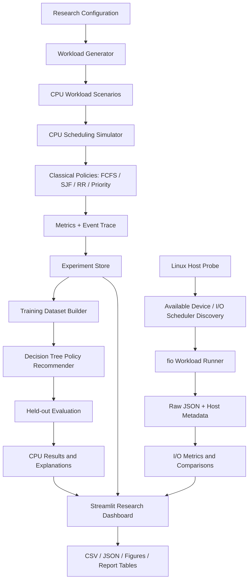

# Implementation Plan: Intelligent Workload-Aware Scheduling Lab

**Project title:** Intelligent Workload-Aware Scheduling in Operating Systems: A Comparative Study of CPU and I/O Resource Management  
**Course:** Operating Systems for Smart Technologies  
**Primary focus:** CPU scheduling (approximately 70–75% of project effort)  
**Secondary focus:** Linux block I/O scheduling (approximately 25–30% of project effort)  
**Implementation target:** Python + Streamlit + scikit-learn + Linux `fio` experiments

---

## 0. Project brief and non-negotiable scope

### 0.1 What the team is investigating

The project investigates one central question:

> **Can workload characteristics help us choose a more suitable scheduling policy, and does this idea remain useful when we move from CPU scheduling to storage I/O scheduling?**

The project has two connected but technically separate experiments:

1. **CPU experiment (main):** Build a discrete-event CPU scheduling simulator, implement classical algorithms, generate controlled workloads, and train an interpretable machine-learning model to recommend a policy/configuration for a workload. Evaluate the recommendation on unseen workload scenarios.
2. **I/O experiment (add-on):** On a Linux machine, use `fio` to benchmark safe file-backed I/O workloads under the I/O schedulers that the selected block device actually exposes. Compare throughput and latency across workload types. Derive a small, evidence-based recommendation for the tested machine and workload conditions.

The shared principle is workload awareness. The CPU experiment uses a learned policy recommender. The I/O experiment checks whether measured performance also varies with workload type and, where enough configurations are available, identifies which available I/O scheduler performed best for each workload.

### 0.2 What the project is not

The implementation and report **must not** claim any of the following:

- That the team modified Linux's kernel CPU scheduler.
- That a Streamlit simulator is a real kernel scheduler.
- That the ML model directly controls the live Linux CPU scheduler.
- That the I/O experiment proves a scheduler is universally best across devices.
- That the project invents a new scheduling algorithm or a new ML architecture.
- That synthetic CPU workloads are production traces or real-world OS telemetry.
- That an ML recommendation is an improvement unless the held-out experiment demonstrates it.

The CPU component is a controlled educational simulation of classical scheduling concepts. Modern Linux fair scheduling is not simply the old textbook CFS algorithm: Linux documentation describes the transition toward EEVDF beginning with Linux 6.6. Our project will mention this as current context, but it will not attempt to reproduce EEVDF. The Linux I/O component is a real benchmark of the selected host/device, subject to its exposed schedulers and permissions.

### 0.3 Expected original contribution

The team's contribution is an **independent, reproducible comparative investigation**, not a novel kernel algorithm:

1. A documented workload generator and experiment matrix.
2. An independently implemented CPU scheduling simulator and validated classical baselines.
3. A transparent Decision Tree-based selector trained from the team's own baseline experiment results.
4. A held-out evaluation against fixed scheduling choices, with trade-offs and model overhead reported.
5. A safe Linux I/O benchmarking workflow, including hardware/kernel discovery and raw result capture.
6. A research dashboard that connects every chart and conclusion to saved experiment runs.

A finding that the ML selector does not beat a traditional baseline in some conditions is valid and must be reported honestly.

---

## 1. Research questions, hypotheses, and success criteria

Create `docs/RESEARCH_PROTOCOL.md` before running the full experiment. Record the hypotheses and primary metrics there, then do not change them after inspecting the final test set without documenting the change as exploratory analysis.

### 1.1 Research questions

- **RQ1 (CPU):** How do FCFS, SJF, Round Robin, and non-preemptive Priority scheduling compare across CPU-bound, I/O-bound, interactive, mixed, and bursty-arrival workloads?
- **RQ2 (CPU + ML):** Can a lightweight model use workload-level features to recommend a policy/configuration that performs better than a fixed policy on unseen workload scenarios?
- **RQ3 (I/O add-on):** On the tested Linux device, how do the available block I/O schedulers behave under sequential, random, and mixed read/write workloads?
- **RQ4 (trade-offs):** How much decision overhead does the recommender add, and are there workloads where a traditional policy remains the better choice?

### 1.2 Hypotheses to test (not assume)

- **H1:** No single classical CPU scheduling policy will be best across every workload family and every metric.
- **H2:** A Decision Tree trained on workload-level features will select a CPU policy/configuration with lower held-out composite cost than at least one fixed-policy baseline in some workload families.
- **H3:** The workload-aware selector will not necessarily outperform the best fixed policy in every scenario; its value, if any, will be in reducing average loss across a varied workload set.
- **H4:** The measured Linux I/O scheduler ranking will vary with workload type on at least some tested configurations. If the device exposes only one scheduler, this hypothesis cannot be tested as a scheduler comparison and that limitation must be reported.
- **H5:** The model's recommendation latency will be small compared with the simulated workload duration, but it will be measured separately rather than silently included in simulated CPU metrics.

### 1.3 What counts as success

Success is **not** defined as “AI wins.” Success means:

- All classical baselines pass correctness tests.
- Experiments run from saved configurations and fixed seeds.
- The ML model is evaluated on scenarios excluded from training and validation.
- Baseline and ML results are generated from identical workload instances.
- CPU metrics are calculated consistently and independently validated.
- I/O tests only run on a disposable file in an explicitly selected directory; no raw block-device writes are performed.
- Raw logs, metadata, parameters, and environment information are retained.
- The final report distinguishes observed results, interpretation, limitations, and speculation.

---

## 2. Project architecture

### 2.1 High-level architecture



### 2.2 Layer responsibilities

| Layer | Responsibility | Must not do |
|---|---|---|
| `core/` | Process state, simulation clock, CPU dispatch, event ordering, metric calculation | Contain Streamlit code or ML training code |
| `schedulers/` | Implement each CPU scheduling policy behind one interface | Generate workloads or calculate report charts |
| `workloads/` | Generate seeded scenarios and extract pre-execution features | Read post-run performance metrics when making a pre-run recommendation |
| `experiments/` | Execute matrices, pair identical traces across policies, log runs and maintain the experiment registry | Delete or overwrite raw results |
| `ml/` | Build training labels, train, validate, explain and evaluate the policy recommender | Train on the final test split |
| `io_lab/` | Probe Linux host, build safe `fio` jobs, parse output, document scheduler changes | Write directly to a raw block device |
| `reporting/` | Produce tables, figures, exports and summaries from saved results | Invent missing values or hide failed runs |
| `ui/` | Display controls, methods, experiment results and logs | Recompute scientific results differently from the experiment engine |

### 2.3 Proposed repository structure

```text
intelligent-scheduling-lab/
├── README.md
├── pyproject.toml
├── requirements-lock.txt
├── .gitignore
├── .streamlit/
│   └── config.toml
├── configs/
│   ├── cpu_defaults.yaml
│   ├── cpu_experiment_matrix.yaml
│   ├── ml_config.yaml
│   └── io_defaults.yaml
├── docs/
│   ├── IMPLEMENTATION_PLAN.md
│   ├── PROJECT_STATUS.md
│   ├── RESEARCH_PROTOCOL.md
│   ├── LITERATURE_REVIEW.md
│   ├── ARCHITECTURE.md
│   ├── UI_SPECIFICATION.md
│   ├── DATA_DICTIONARY.md
│   ├── LIMITATIONS.md
│   ├── references.bib
│   └── research_log.md
├── src/
│   └── scheduling_lab/
│       ├── app.py
│       ├── core/
│       │   ├── models.py
│       │   ├── process.py
│       │   ├── simulator.py
│       │   ├── event_engine.py
│       │   ├── metrics.py
│       │   └── validation.py
│       ├── schedulers/
│       │   ├── base.py
│       │   ├── fcfs.py
│       │   ├── sjf.py
│       │   ├── round_robin.py
│       │   ├── priority.py
│       │   └── registry.py
│       ├── workloads/
│       │   ├── generator.py
│       │   ├── profiles.py
│       │   ├── features.py
│       │   └── schemas.py
│       ├── experiments/
│       │   ├── runner.py
│       │   ├── matrix.py
│       │   ├── registry.py
│       │   ├── artifacts.py
│       │   └── logging.py
│       ├── ml/
│       │   ├── dataset.py
│       │   ├── objective.py
│       │   ├── split.py
│       │   ├── train.py
│       │   ├── evaluate.py
│       │   ├── recommender.py
│       │   └── explain.py
│       ├── io_lab/
│       │   ├── host_probe.py
│       │   ├── scheduler_discovery.py
│       │   ├── fio_jobs.py
│       │   ├── fio_runner.py
│       │   ├── fio_parser.py
│       │   └── io_analysis.py
│       ├── reporting/
│       │   ├── charts.py
│       │   ├── tables.py
│       │   └── exports.py
│       └── ui/
│           ├── navigation.py
│           ├── components/
│           └── pages/
│               ├── overview.py
│               ├── cpu_lab.py
│               ├── io_lab.py
│               ├── experiments.py
│               ├── research_log.py
│               └── methodology.py
├── scripts/
│   ├── run_cpu_suite.py
│   ├── train_recommender.py
│   ├── run_io_probe.py
│   ├── run_fio_suite.py
│   ├── export_report.py
│   └── io_scheduler_control.sh
├── data/
│   ├── generated/          # generated CPU scenarios; not hand-edited
│   └── scratch/            # disposable fio test file; ignored by git
├── models/                 # trained model artifacts; metadata committed, large models optional
├── results/
│   ├── runs/               # immutable per-run artifacts
│   ├── tables/
│   └── figures/
├── logs/
│   └── application.log
└── tests/
    ├── unit/
    ├── integration/
    ├── fixtures/
    └── acceptance/
```

**Architecture rule:** The UI calls service functions in `experiments/`, `ml/`, and `io_lab/`. Core simulation and metrics must be usable from the command line without launching Streamlit.

---

## 3. Technology choices

| Area | Recommended technology | Reason |
|---|---|---|
| Language | Python 3.11 or 3.12 | Broad support for scientific packages and simple local setup |
| UI | Streamlit | Fast local research dashboard; no separate frontend/backend deployment required |
| Charts | Plotly | Interactive Gantt-like timelines, comparative bars and latency plots |
| Data handling | pandas + NumPy | Reproducible experiment tables and analysis |
| ML | scikit-learn | Interpretable Decision Tree; low training overhead |
| Host metrics | psutil + `/proc` + sysfs | Linux process/host information without writing a kernel module |
| I/O benchmark | `fio` CLI | Reproducible job-file based workload generation and JSON output |
| Configuration | YAML | Human-readable experiment matrices |
| Testing | pytest | Unit, integration and acceptance checks |
| Logging | Python `logging` + JSONL | Machine-readable event trails and readable app logs |

Keep the first version local-first. Do not add Docker, a database server, authentication, cloud deployment or a React frontend unless a concrete requirement appears. A local SQLite index may be added later if reading JSON manifests becomes slow; JSON/CSV run artifacts are sufficient for the MVP.

---

## 4. CPU scheduling simulator: detailed implementation

This is the core of the project and must be completed before the I/O add-on.

### 4.1 Process and burst model

Represent each process as a PCB-like record with:

- `pid`
- `arrival_time`
- `priority` (document whether smaller or larger number means higher priority)
- `cpu_bursts`: ordered list of non-negative CPU burst lengths
- `io_bursts`: ordered list of I/O waiting durations between CPU bursts
- `current_burst_index`
- `remaining_cpu_in_burst`
- `state`: NEW, READY, RUNNING, BLOCKED, TERMINATED
- `first_start_time`
- `completion_time`
- `total_cpu_time`
- `total_ready_wait`
- `total_blocked_time`
- `dispatch_count`

A process alternates between CPU and I/O phases, for example:

`CPU(5) -> I/O wait(8) -> CPU(2) -> I/O wait(4) -> CPU(3) -> TERMINATED`.

This models the fact that an I/O-bound process can leave the ready queue while waiting for I/O and later re-enter it. It does **not** simulate a block-device request queue; that is the separate `fio` experiment.

### 4.2 Simulation model

Use a deterministic, single-CPU discrete-event or tick-based simulation. Prefer a simple, well-tested time progression over prematurely optimising the engine.

At each simulated timestamp, define and document one fixed event order:

1. Complete any CPU burst ending at this timestamp.
2. Move processes whose simulated I/O wait ends now from BLOCKED to READY.
3. Admit newly arrived processes.
4. Apply preemption/quantum-expiry rules, if relevant.
5. Select a READY process if the CPU is idle.
6. Execute the selected process for the next time unit or until the next event, depending on the engine design.
7. Update state, counters and the event log.

For simultaneous arrivals or wake-ups, use deterministic tie-breaking: earlier arrival/wake timestamp, then PID. Do not allow Python dictionary ordering to decide scheduling outcomes accidentally.

The simulator must support CPU idle time. It must terminate if all processes terminate, and detect a deadlocked/broken simulation if unfinished processes exist but no future event can occur.

### 4.3 Algorithms in the MVP

Implement these four policies behind a common scheduler interface:

1. **FCFS:** non-preemptive, ready-queue arrival order.
2. **SJF:** non-preemptive, choose the ready process with the shortest next CPU burst. Because the simulator knows generated burst lengths, label this as an offline/clairvoyant textbook baseline rather than claiming a real kernel knows the future.
3. **Round Robin:** preemptive, configurable time quantum. The default candidate values should be 2, 5 and 10 simulated time units; allow configuration in YAML.
4. **Priority:** non-preemptive priority scheduling, with deterministic tie-breaking. Add optional aging only as a later extension, not part of the first comparison.

Do not add Multilevel Feedback Queue, EEVDF, reinforcement learning or neural scheduling in the MVP. They increase complexity without being necessary to answer the research questions.

### 4.4 Metrics and exact definitions

Calculate metrics from the event trace, not from formulas that assume every process has one CPU burst.

| Metric | Definition |
|---|---|
| Turnaround time | `completion_time - arrival_time` |
| Response time | `first_start_time - arrival_time` |
| Ready waiting time | Total time spent in READY state; do not count BLOCKED time |
| CPU busy time | Sum of executed CPU time across all processes |
| CPU utilisation | `CPU busy time / total simulated makespan × 100` |
| Throughput | Number of completed processes / makespan |
| Context switches | Number of transitions from one process PID to a different process PID; define whether idle transitions are excluded (recommended: exclude idle transitions) |
| Maximum ready wait | Maximum per-process ready waiting time |
| p95 response time | 95th percentile of per-process response times |
| Jain fairness index (optional) | Report only if a defensible per-process service measure is specified; do not use it as a substitute for starvation analysis |

Also keep per-process metrics. Aggregate averages alone can hide a process that waited a very long time.

### 4.5 Correctness checks

Before any ML work:

- Test known textbook examples where Gantt-chart order and metrics can be hand-calculated.
- Test zero/invalid burst rejection, all-zero arrivals, idle gaps, simultaneous arrivals, repeated I/O blocking, and a process with one CPU burst.
- Check conservation: sum of process CPU burst durations equals total CPU busy time once every process completes.
- Check that `turnaround >= response >= 0` for every completed process.
- Check that ready waiting and blocked waiting do not overlap.
- Run the same scenario and policy twice; the full output must be identical.
- Test Round Robin with quantum larger than every burst; it should behave like FCFS for the same arrival/tie rules where applicable.
- Verify that every process eventually terminates for finite valid workloads.

**Definition of done:** Each policy has unit tests, a validated Gantt trace, stable metrics, and identical results across repeated executions using the same configuration and seed.

---

## 5. Workload generation and feature engineering

### 5.1 Workload families

Create controlled synthetic workload profiles. Name them honestly as generated profiles, not production traces.

| Profile | Characteristics to generate | Why it matters |
|---|---|---|
| CPU-bound | Long CPU bursts; few or no I/O waits | Tests throughput and long-burst handling |
| I/O-bound | Short CPU bursts; frequent/long I/O waits | Tests how blocked processes rejoin the ready queue |
| Interactive | Short CPU bursts, frequent arrivals, short I/O waits | Tests response time |
| Mixed | Mixture of CPU-bound, I/O-bound and interactive processes | Tests heterogeneous competition |
| Bursty arrivals | Groups of processes arrive close together, followed by quieter intervals | Tests queue buildup and changing load |

Generate process attributes from parameterised ranges/distributions in YAML. The distributions, ranges, random seeds and generated process table must be saved for every scenario.

### 5.2 Workload features available before execution

Only use features that would be available before making the recommendation. Candidate features:

- process count
- mean and standard deviation of first CPU burst
- coefficient of variation of CPU burst lengths
- mean I/O wait duration
- fraction of processes with more than one CPU burst
- CPU-to-I/O burst ratio
- mean and standard deviation of arrival gaps
- proportion of short-burst processes
- priority distribution summary
- burstiness/arrival-concentration measure

**Leakage rule:** Do not feed completed response time, waiting time, turnaround time, context switches or any post-simulation result into the pre-run recommender. Those are labels/outcomes, not input features.

### 5.3 Experiment scale

Target the following full CPU dataset after the pilot passes:

- 5 workload families
- 100 independently seeded scenarios per family
- 500 total scenarios
- Identical generated process table replayed against each candidate policy/configuration
- Candidate configurations: FCFS, SJF, Priority, RR(q=2), RR(q=5), RR(q=10)
- Approximately 3,000 policy-scenario evaluations

If time or hardware is constrained, reduce to 50 scenarios per family (250 total), but record the change in the research protocol. Never silently reduce the experiment count after results look inconvenient.

---

## 6. ML policy recommender

### 6.1 What the model predicts

The model predicts a **scheduling policy/configuration label** for a workload scenario. It does not predict which PID the live Linux kernel will schedule next.

Example labels:

- `FCFS`
- `SJF`
- `PRIORITY`
- `RR_Q2`
- `RR_Q5`
- `RR_Q10`

### 6.2 How training labels are created

For each generated scenario:

1. Run all six candidate configurations on the exact same process workload.
2. Save the metric results.
3. Compute a predeclared composite cost for each candidate.
4. The lowest-cost candidate becomes the scenario's training label.
5. Save the score and all component metrics, not only the winning label.

For the initial protocol, use a transparent weighted score based on within-scenario min-max normalised values:

`CPU cost = 0.30 × response_cost + 0.25 × waiting_cost + 0.20 × turnaround_cost + 0.15 × context_switch_cost + 0.10 × utilisation_cost`

Where lower is better for each component. For utilisation, `utilisation_cost` is the normalised inverse of CPU utilisation. Normalise each component across the candidate policies for the same scenario; if all policies have the same value for a component, assign the same neutral component value to all candidates for that scenario. Keep the weights in `configs/ml_config.yaml` and in `RESEARCH_PROTOCOL.md`.

This is a team-defined research objective, not a standard OS metric. Therefore:

- Display the component metrics alongside the composite score.
- Conduct a sensitivity check with at least one alternative weight profile.
- Do not claim a policy is universally optimal because it won the chosen composite score.
- Report the best algorithm separately for response time, waiting time, turnaround and context switches.

### 6.3 Model choice

MVP model: scikit-learn `DecisionTreeClassifier` with a limited depth (start with max depth 4), minimum leaf size and fixed random state. This is intentionally simple and explainable.

Optional extension: compare against `RandomForestClassifier`. Do this only after the Decision Tree pipeline is correct. The Decision Tree remains the principal model because the rule path can be shown to an examiner.

### 6.4 Train/validation/test protocol

- Split by **scenario ID**, not by individual policy rows. All policy outcomes for one generated scenario must remain in the same split.
- Use a stratified 70% train / 15% validation / 15% test split where feasible.
- Fit preprocessing and the model using training data only.
- Use validation data for depth/parameter selection.
- Freeze the model and evaluate once on the held-out test set.
- Save split IDs and the random seed.
- Do not use test results to choose weights, features, algorithms or model depth.

### 6.5 Required baselines

Evaluate the ML-selected policy against:

1. Always FCFS.
2. Always RR(q=5) as the fixed Round Robin baseline.
3. Best fixed policy chosen using training/validation data only (never the test set).
4. Per-scenario oracle: the best candidate for each test scenario. This is an unattainable upper-bound reference, not a deployable baseline.

### 6.6 ML evaluation metrics

- policy-label accuracy (secondary; classification accuracy alone is not enough)
- average composite cost on held-out scenarios
- relative regret versus per-scenario oracle
- proportion of test scenarios where ML beats RR(q=5)
- proportion of scenarios where the best fixed policy beats ML
- results per workload family
- confusion matrix and interpretable decision paths
- inference time (median and p95 over repeated predictions)

Measure prediction latency separately with `time.perf_counter_ns`. Do not subtract it from simulated response time or claim that it is kernel overhead. It is the cost of the research tool's recommendation step.

### 6.7 Safe fallback

If the model file is missing, incompatible or fails validation, the UI must show **“Model unavailable — using selected fixed baseline”** and run a traditional baseline. It must never silently claim that the ML selector was used.

**Definition of done:** A reproducible training command creates the model and metadata; a held-out evaluation produces a saved comparison table; a model explanation is available; a no-model fallback is tested.

---

## 7. I/O scheduling add-on: real Linux experiment

This part is an exploratory extension. It must not block completion of the CPU research.

### 7.1 Host discovery first

Implement a read-only probe that records:

- Linux distribution and kernel release
- CPU model and logical CPU count
- RAM size
- `fio` version
- selected block device name/model
- filesystem and mount point of the test directory
- I/O schedulers listed by `/sys/block/<device>/queue/scheduler`
- currently selected scheduler
- whether the scheduler file is writable by the current user
- whether the target environment appears virtualised/containerised (best-effort, with uncertainty)

Only offer schedulers that the selected device actually exposes. Kernel documentation describes scheduler switching through `/sys/block/<device>/queue/scheduler`, but available choices depend on the system/device/kernel. Common names can include `none`, `mq-deadline`, `bfq` and `kyber`; do not assume all are present.

### 7.2 Safe testing rules (mandatory)

- **Never write to `/dev/sda`, `/dev/nvme0n1`, a partition, or any raw block device.**
- All fio workloads must target a disposable test file inside a user-selected scratch directory.
- Default scratch file size: 512 MiB; make it configurable up to 1 GiB.
- Display the full target path, file size, selected device and test type before execution.
- Require explicit user confirmation before any write-heavy benchmark.
- Do not automatically elevate privileges or invoke `sudo` from the Streamlit process.
- Scheduler switching is a separate manual/explicit operation. Record the previous setting and provide a restore command. If permission is not available, mark the scheduler as unavailable rather than bypassing permissions.
- After a scheduler change, read the sysfs file again to verify the active setting.
- Always restore the original scheduler after the benchmark, using a guarded `try/finally` path where the user has explicitly authorised switching. Log restoration success/failure.
- If the selected device is the OS/system disk, show a strong warning and require an extra confirmation; preferably use a non-system test device.
- If running inside WSL, a container, or a VM where scheduler changes are unavailable, run only the safe benchmark under the currently exposed configuration and report the limitation.

### 7.3 I/O workload matrix

Use `fio` job files and JSON output. Initial workload types:

1. Sequential read.
2. Random read.
3. Random write to the disposable test file.
4. Mixed random read/write (for example 70% reads / 30% writes).

Initial configuration should be moderate, for example 10–15 seconds per run plus a short ramp-up, one job, fixed block size and queue depth per workload profile. Store every job file and its exact parameters. Use direct I/O (`direct=1`) where supported and record whether it was successfully enabled. Do not silently switch I/O engines or direct-I/O settings; record any fallback and explain it.

Run one warm-up followed by at least three measured repetitions for the pilot. For final report tables, aim for five measured repetitions for each selected workload/scheduler combination if time permits. Use the same job parameters, target file size and device for every scheduler comparison.

### 7.4 I/O metrics

Capture from fio JSON:

- read/write bandwidth (MiB/s)
- IOPS
- average completion latency
- p95 and p99 completion latency, where fio reports them
- read/write mix and block size
- job runtime and error status

Report median and spread across repetitions. Do not overstate statistical significance from a small number of real-device runs.

### 7.5 I/O interpretation

- Compare schedulers only when the same physical/virtual device, filesystem, test file location and workload configuration were used.
- Treat results as specific to the tested machine and environment.
- If the device exposes only `none`, there is no scheduler comparison to make. Still complete the host probe and workload benchmarking, then report that the add-on could not compare multiple policies on this hardware.
- Do not train a general I/O ML model from a handful of measurements. The initial I/O result is an empirical workload-versus-policy comparison. An optional small selector is allowed only if enough distinct workload configurations and scheduler measurements have been collected.

**Definition of done:** Host report saved; fio job files saved; raw JSON captured; each run has parameters and exit status; target safety checks pass; scheduler availability and restoration are documented.

---

## 8. Research experiment protocol and reproducibility

### 8.1 Controlled variables

For CPU simulation, hold constant across policy comparisons:

- process scenario and seed
- arrival times, CPU bursts, I/O waits and priorities
- CPU count (one simulated CPU in the MVP)
- context-switch cost configuration
- event ordering and tie-breaking rules
- metric definitions
- composite-score weights

For I/O tests, hold constant where possible:

- host, kernel, device, filesystem and mount point
- test file path and size
- fio version and job file
- block size, queue depth, job count and duration
- warm-up/repetition procedure
- background system activity as far as practical

### 8.2 Experiment phases

| Phase | Purpose | Scale | Output |
|---|---|---:|---|
| CPU pilot | Validate simulator and inspect sensible metric ranges | 2–5 scenarios per family | Pilot report, bug list |
| CPU baseline study | Compare classical policies | Target 500 scenarios | Per-scenario metrics and summary tables |
| ML training | Build selector from training scenarios | Same scenario set, grouped split | Model, config, feature list, split IDs |
| ML held-out evaluation | Test generalisation | Reserved 15% test set | Test comparison and regret analysis |
| CPU robustness | Try alternate quantum values and composite weights | Small predeclared sensitivity matrix | Sensitivity tables |
| I/O pilot | Confirm safe path, fio parsing, available schedulers | One workload per available scheduler | Host report and pilot logs |
| I/O final | Compare selected workloads under available schedulers | 4 workload families × available schedulers × 3–5 repeats | Raw fio outputs and summary |

### 8.3 Repetition and statistics

- CPU simulation is deterministic. Do not repeat an identical seed and count identical deterministic replays as independent samples. Generate independent scenarios with separate seeds; run all policies on each same scenario to create paired comparisons.
- Report mean and standard deviation, plus median and interquartile range where distributions are skewed.
- Use paired comparisons because each policy is run against the same scenario. A paired t-test may be used if assumptions are reasonable; otherwise use a Wilcoxon signed-rank test. Report effect size and confidence intervals where feasible.
- Prefer bootstrap 95% confidence intervals for average differences across scenarios.
- For I/O tests, show all repetitions or their spread. Three repetitions are a pilot minimum, not strong evidence for broad claims.
- Report all workload families, including cases where ML loses. Do not select only favourable graphs.

### 8.4 Step-wise research log

Every experiment must generate both machine-readable logs and a human-readable research entry.

**Per-run artifact folder:** `results/runs/<run_id>/`

Required files for CPU runs:

- `run_manifest.json`: run ID, timestamp, git commit, Python/package versions, OS/host metadata, scenario ID, seed, policy, quantum/priority settings, model version, config hash, status.
- `scenario.json`: exact generated process table and workload-generation parameters.
- `event_trace.jsonl`: chronological state transitions, dispatches, preemptions, CPU burst completions, I/O blocking/wakeups and scheduler decisions.
- `timeline.csv`: compact execution intervals for Gantt charts.
- `process_metrics.csv`: per-process arrival, first start, finish, CPU time, READY waiting, BLOCKED time, response and turnaround.
- `summary_metrics.json`: aggregate metrics and composite score components.
- `stdout.log` and `stderr.log` when launched through a CLI runner.

Required files for I/O runs:

- `run_manifest.json`: host, kernel, device, scheduler before/after, test directory, fio version, job configuration, repetition, status.
- `host_probe.json`
- `fio_job.fio`
- `fio_output.json` (raw fio JSON; never replace with a manually edited summary)
- `fio_stdout.log` / `fio_stderr.log`
- `parsed_metrics.json`
- `scheduler_change.log` and restoration status if a scheduler was changed.

**Event trace minimum fields:**

`event_id`, `sim_time`, `event_type`, `pid`, `state_before`, `state_after`, `cpu_pid_before`, `cpu_pid_after`, `ready_queue`, `blocked_processes`, `policy`, `decision_reason`.

**Research log entry template (`docs/research_log.md`):**

```markdown
## EXP-<run-group-id> — <date>
- Research question / hypothesis:
- What was changed:
- Workload family and sample count:
- Policies/configurations tested:
- Controlled variables:
- Run IDs:
- Observations (numbers, not interpretation only):
- Interpretation:
- Unexpected behaviour / failures:
- Limitations or deviations:
- Next experiment:
- Conclusion status: preliminary / supported / inconclusive / rejected
```

The app may generate a draft observation section from metrics, but a human must review and write the interpretation. Never have the model invent conclusions from missing data.

### 8.5 Traceability from conclusion to evidence

Create `docs/CONCLUSION_EVIDENCE_MATRIX.md` before final submission:

| Claim ID | Claim | Supporting run IDs | Metric/table/figure | Contradictory evidence | Confidence / limitation |
|---|---|---|---|---|---|

Every statement in the final conclusion that claims improvement must point to one or more run groups and a measured metric.

---

## 9. Dashboard and results UI specification

The dashboard is a research instrument, not a generic AI SaaS landing page. It should look like a compact, carefully typeset systems-performance laboratory: strong hierarchy, dense but readable tables, meaningful charts and clear experimental status.

### 9.1 Required UI design skills

Install these project-level agent skills before implementing the UI. The skills CLI requires a modern Node.js version; its current documentation states Node.js 22.20 or later. Run from the repository root and select the coding agent you use when prompted.

```bash
# Distinctive frontend design and explicit anti-template / anti-AI-slop guidance
npx skills add anthropics/skills --skill frontend-design

# Review against web interface, interaction and accessibility guidelines
npx skills add vercel-labs/agent-skills --skill web-design-guidelines

# Product design workflow: shape, critique, audit and polish
npx skills add pbakaus/impeccable --skill impeccable
```

Official skill sources:

- Anthropic `frontend-design`: https://github.com/anthropics/skills/tree/main/skills/frontend-design
- Vercel `web-design-guidelines`: https://github.com/vercel-labs/agent-skills/tree/main/skills/web-design-guidelines
- Impeccable: https://github.com/pbakaus/impeccable
- Skills CLI: https://github.com/vercel-labs/skills

After installation, verify the skills are present with `npx skills list`. The coding agent must read the installed skill instructions before UI design, then apply the project-specific rules below. Skills are guidance, not a substitute for visual review.

### 9.2 Project UI rules (must be saved as `UI_DESIGN_RULES.md`)

**Visual direction:** “Operating Systems Research Workbench.” Functional, precise, editorial and instrument-like. The UI should feel like a well-designed analysis tool used by a systems researcher, not a generic analytics template.

**Palette:**

- Canvas: `#F3F5F6` (cool paper grey)
- Main surface: `#FFFFFF`
- Primary text: `#17232D`
- Secondary text: `#5E6B75`
- Border: `#D9E0E4`
- Primary accent: `#147D78` (teal)
- Secondary accent: `#345F86` (blue)
- Highlight / caution: `#C17A24` (amber)
- Error: `#B64D4D`
- Success: `#34765A`

Use accent colours to encode meaning, not as decoration. Keep chart colours consistent across all pages: FCFS grey, SJF teal, RR amber, Priority blue, ML-selected policy dark green/teal with a distinct outline or marker. Do not rely on colour alone; include labels and legends.

**Typography:** Use IBM Plex Sans for interface text and IBM Plex Mono for numerical values, trace IDs and code-like metadata, with sensible system fallbacks. Do not use a display font for every heading. Keep numeric columns aligned and use tabular numerals.

**Layout:**

- Desktop-first at 1366px and above, but usable down to tablet width.
- Persistent left navigation approximately 230–250px wide.
- Compact top bar approximately 56–64px high with project name, current mode and environment status.
- Main content max width around 1440px, with 24–32px outer padding and consistent spacing.
- Use a 12-column layout on wide screens; collapse to one column on narrow screens.
- Use cards only when they group a coherent unit of information. Prefer tables, aligned sections and clear dividers over wrapping every element in a rounded card.

**Forbidden / strongly discouraged AI-slop patterns:**

- No purple/blue gradient hero backgrounds.
- No glassmorphism, glowing borders, floating blurred blobs or decorative mesh gradients.
- No row of three or four identical feature cards as the default layout.
- No oversized fake KPI numbers without units, context or a comparison baseline.
- No generic “AI-powered / intelligent insights” marketing copy.
- No random emoji in navigation or metrics; use a consistent icon set only where it improves recognition.
- No fake live indicators, invented timestamps, placeholder charts presented as actual results, or fabricated sample findings.
- No donut charts used merely to fill space.
- No animation that distracts from reading results.
- No excessive pills, badges, shadows, rounded containers or all-caps micro-labels.
- No arbitrary chart colours per render; maintain a fixed policy-to-colour mapping.

**UX rules:**

- Every metric must include a unit or clear definition.
- Every chart must have a title, axis labels, legend where relevant and a useful empty state.
- Show whether data is simulated or measured on a real Linux host.
- Show the selected run ID and scenario/configuration alongside results.
- Failed or skipped runs must remain visible with their status; never silently omit them.
- Make destructive or write-heavy I/O actions explicit and confirmable.
- All controls need labels, keyboard focus and understandable validation errors.
- No control may appear active when the associated experiment/model is unavailable.
- Provide download/export actions for source result tables.

### 9.3 Navigation and pages

Sidebar navigation, in this exact order:

1. **Overview**
2. **CPU Scheduling Lab**
3. **I/O Scheduling Lab**
4. **Experiment Registry**
5. **Research Log**
6. **Methodology & Reproducibility**

The title and status bar should remain consistent across pages.

#### Page A — Overview

Purpose: communicate what the project studies and show the current state of evidence.

Layout:

- Top title: “Scheduling Research Workbench”. Subtitle: “Workload-aware CPU and Linux I/O scheduling experiments.”
- A compact environment/status strip: `CPU simulator: ready/not ready`, `ML model: trained/not trained`, `Linux I/O: available/limited/not probed`, `Latest completed run`.
- Main comparison chart: grouped horizontal bars for the selected primary CPU metric across FCFS, SJF, RR and Priority, with ML selector shown separately. Default metric: average response time. Include a metric selector and workload-family selector.
- Beside the chart, a “Current recommendation” panel showing the selected policy, model confidence if available, and the short Decision Tree path/reason. State explicitly that this is a simulator recommendation.
- Lower section: latest experiment runs table (`Run ID`, `Date`, `Experiment`, `Workload`, `Policy/config`, `Status`, `Open`).
- Lower secondary section: “Research questions” with RQ1–RQ4 and status (`not tested`, `in progress`, `evidence collected`).

Do not show summary performance values until real experiment result files exist. Before that, show empty states explaining how to run the first experiment.

#### Page B — CPU Scheduling Lab

Purpose: allow an examiner to run a controlled comparison and understand the scheduling decisions.

Top control area:

- Workload profile selector: CPU-bound, I/O-bound, Interactive, Mixed, Bursty arrivals, Custom.
- Number of processes (default 10; bounded input).
- Random seed (visible and editable).
- Arrival-rate / burst-variation controls relevant to the selected profile.
- Candidate policies checkboxes; RR quantum inputs appear only when RR is selected.
- Context-switch cost (default 0, with an explanation that it is a simulator parameter).
- Run buttons: `Run selected baselines`, `Run ML recommendation`, `Run full comparison`.
- Display a compact configuration summary before execution.

Results area, in this order:

1. **Scheduling timeline:** Plotly Gantt/timeline view showing process execution intervals on a shared time axis. Add a policy selector so the same scenario can be inspected under different algorithms. Distinguish idle CPU intervals visually.
2. **Performance summary:** a comparison table with average waiting, response, turnaround, CPU utilisation, throughput and context switches. Include units.
3. **Per-process details:** a table with PID, arrival, first start, completion, ready wait, blocked time, response and turnaround.
4. **ML explanation:** selected policy/configuration, predicted class probabilities if meaningful, feature values and the Decision Tree path. Avoid implying causality from feature importance.
5. **Run details:** scenario ID, seed, run ID, model version, configuration hash and links to raw logs.

#### Page C — I/O Scheduling Lab

Purpose: run and understand real, device-specific Linux I/O measurements safely.

Top “Host and device” panel:

- Kernel release, distribution, CPU, RAM, fio version.
- Selected device, device model, mount point and filesystem.
- Available I/O scheduler list and currently selected scheduler.
- Explicit notice if running in a VM/container or if multiple schedulers cannot be compared.

Safety panel:

- Scratch directory and exact target-file path.
- Test file size.
- Workload selection (sequential read, random read, random write, mixed).
- Duration, block size, queue depth, repetitions.
- Read-only probe button.
- Scheduler-switch instructions and restore status.
- A required confirmation checkbox before write-heavy testing.
- Never offer a raw-device target.

Results:

- IOPS comparison chart.
- Bandwidth comparison chart (MiB/s).
- Average, p95 and p99 latency chart/table.
- Repeat-level results table, not only a single aggregate.
- Warnings and limitations (unsupported scheduler, permission denied, fio failure, device type).
- A short “What this experiment supports” note limited to the tested host/device.

#### Page D — Experiment Registry

- Search/filter by CPU/I/O, status, workload family, date and policy.
- Table of all runs, including failed/skipped runs.
- Selecting a run opens its manifest, parameters, metrics, event trace, stdout/stderr and artifacts.
- Compare selected runs only when their comparison is valid. Warn if device, scenario, seed, metrics or config differ.
- Export selected rows and all raw files as CSV/JSON/ZIP.

#### Page E — Research Log

- Chronological experiment groups with hypothesis, run IDs, observations, interpretation, limitations and next experiment.
- Allow human-authored notes and status labels: preliminary, supported, inconclusive, rejected.
- Show links to exact raw run artifacts.
- Clearly distinguish auto-generated numeric summaries from human interpretation.

#### Page F — Methodology & Reproducibility

- Display RQ1–RQ4 and H1–H5.
- Show definitions of all performance metrics and composite score weights.
- Show train/validation/test split counts and seed.
- Show model type, parameters, feature list and version.
- Display Linux host metadata and fio configuration for I/O experiments.
- Provide a “Reproduce this experiment” command/config export.
- Show limitations and environment caveats.

### 9.4 UI acceptance criteria

- All pages use the same typography, spacing, palette and navigation.
- There are no invented results; empty states are used until runs exist.
- CPU Gantt chart, comparison table and per-process details all refer to the same selected run/scenario.
- Every result can be traced to a run ID and a raw artifact.
- I/O safety checks are visible before any write workload.
- Responsive layout is usable on a typical laptop display.
- Keyboard focus, readable contrast and labels are verified.
- Run the installed `frontend-design`, `web-design-guidelines` and `impeccable` critique/audit workflow before declaring UI complete.

---

## 10. CLI workflows and expected commands

The following commands are target interfaces. Implement them as scripts or `python -m` commands with clear `--help` output.

```bash
# Install development dependencies
python -m venv .venv
source .venv/bin/activate
pip install -e ".[dev]"

# Run the test suite
pytest -q

# Run a small CPU pilot
python scripts/run_cpu_suite.py --config configs/cpu_defaults.yaml --pilot

# Run the full CPU experiment matrix
python scripts/run_cpu_suite.py --config configs/cpu_experiment_matrix.yaml

# Build the ML dataset and train the recommender
python scripts/train_recommender.py --config configs/ml_config.yaml

# Evaluate the frozen recommender on the held-out test split
python scripts/train_recommender.py --evaluate-only --split test

# Probe the Linux host and scheduler availability (read-only)
python scripts/run_io_probe.py --output results/host_probe.json

# Run I/O benchmarks only after safe path and permissions have been checked
python scripts/run_fio_suite.py --config configs/io_defaults.yaml --confirm-scratch-file

# Launch dashboard
streamlit run src/scheduling_lab/app.py
```

The agent must implement safe `--dry-run` options for I/O commands. The dry run prints the planned command, file target and scheduler state without writing data or changing kernel settings.

---

## 11. Coding-agent execution protocol

The implementation agent must work in small, verifiable phases. It must not build the entire project in one unreviewed generation pass.

### 11.1 Required project tracking files

- `docs/IMPLEMENTATION_PLAN.md`: this plan; only update if a scope change is approved and log the reason.
- `docs/PROJECT_STATUS.md`: current phase, completed tasks, blockers, latest test command/result, next task.
- `docs/TASK_CHECKLIST.md`: task IDs and checkboxes.
- `docs/DECISIONS.md`: architecture/research decisions with date, reason and impact.
- `docs/RESEARCH_PROTOCOL.md`: frozen research design and changes/deviations.

### 11.2 Agent rules

1. Read the plan and relevant design/research docs before coding.
2. Implement one phase at a time. Do not jump to dashboard polish while core metrics are untested.
3. After each task, run the relevant tests and record the exact command and result in `PROJECT_STATUS.md`.
4. Mark a task complete only when its acceptance criteria are satisfied and test evidence exists.
5. Never create fabricated metric values, fake screenshots, fake run IDs or sample results that look real. Seeded demo data must be explicitly labelled `DEMO / SYNTHETIC`.
6. Do not overwrite raw experiment artifacts. New runs receive new IDs.
7. Do not silently swallow exceptions. Save error messages and mark failed runs as failed.
8. Do not change metric definitions, score weights, train/test split or workload ranges after looking at test results without logging a protocol deviation.
9. Avoid adding dependencies or architectural complexity without documenting why.
10. If an environment-specific operation cannot be performed, record `BLOCKED` or `UNAVAILABLE` with evidence and continue with the rest of the project.
11. Before completing the UI, read the installed design skills and perform design critique/audit/polish.
12. At the end of each phase, provide a concise summary: files changed, commands run, passing/failing tests, artifacts created, open issues and next task.

### 11.3 Task state labels

Use only: `NOT STARTED`, `IN PROGRESS`, `BLOCKED`, `COMPLETE`, `NOT APPLICABLE`.

A blocked/unavailable feature is not complete. It may be accepted as a documented environment limitation if the project still satisfies the core deliverables.

---

## 12. Implementation phases and completion checklist

### Phase 0 — Repository and research setup

- [ ] **P0.1** Create the repository structure and Python package.
- [ ] **P0.2** Add dependency specification, lock/version record, `.gitignore` and Streamlit config.
- [ ] **P0.3** Add `README.md`, `PROJECT_STATUS.md`, `TASK_CHECKLIST.md`, `DECISIONS.md`.
- [ ] **P0.4** Write `RESEARCH_PROTOCOL.md` with RQs, hypotheses, metrics, workloads, candidate policies and split strategy.
- [ ] **P0.5** Install the three design skills and confirm they appear in `npx skills list`.
- [ ] **P0.6** Create `UI_DESIGN_RULES.md` and `UI_SPECIFICATION.md` from this plan.

**Gate:** Repository installs; docs exist; no scientific parameter remains undocumented.

### Phase 1 — CPU simulator foundation

- [ ] **P1.1** Implement process/PCB data model and state transitions.
- [ ] **P1.2** Implement deterministic event ordering and simulation clock.
- [ ] **P1.3** Implement FCFS.
- [ ] **P1.4** Implement SJF.
- [ ] **P1.5** Implement Round Robin with configurable quantum.
- [ ] **P1.6** Implement non-preemptive Priority.
- [ ] **P1.7** Implement Gantt timeline generation.
- [ ] **P1.8** Implement metric calculation and per-process metrics.
- [ ] **P1.9** Add hand-calculated correctness fixtures and edge-case tests.

**Gate:** All baseline algorithms pass tests; same seed/policy returns identical trace and metrics; CPU conservation checks pass.

### Phase 2 — Workload generation and experiment engine

- [ ] **P2.1** Implement the five workload families.
- [ ] **P2.2** Implement seed-controlled scenario generation and scenario export.
- [ ] **P2.3** Implement pre-execution feature extraction and data dictionary.
- [ ] **P2.4** Implement experiment matrix runner that replays identical scenarios against every policy.
- [ ] **P2.5** Implement run IDs and immutable per-run artifact folders.
- [ ] **P2.6** Implement JSON manifest, JSONL event trace, timeline CSV, process metrics CSV and aggregate JSON.
- [ ] **P2.7** Implement experiment registry/index and failure status handling.
- [ ] **P2.8** Run a pilot with 2–5 scenarios per workload family and inspect anomalies.

**Gate:** A pilot can be reproduced from config/seed; run artifacts are complete; failures are visible and preserved.

### Phase 3 — ML recommender and research evaluation

- [ ] **P3.1** Implement composite cost from frozen config weights.
- [ ] **P3.2** Build scenario-level training table from baseline experiment outputs.
- [ ] **P3.3** Implement scenario-grouped stratified 70/15/15 split.
- [ ] **P3.4** Train bounded-depth Decision Tree and save model metadata.
- [ ] **P3.5** Implement explanation/path output for predicted policy.
- [ ] **P3.6** Implement fixed-policy baselines and per-scenario oracle comparison.
- [ ] **P3.7** Implement held-out evaluation and regret metrics.
- [ ] **P3.8** Measure model inference latency separately.
- [ ] **P3.9** Run full CPU matrix (target 500 scenarios; document any reduction).
- [ ] **P3.10** Generate summary tables, confidence intervals and workload-family analysis.
- [ ] **P3.11** Run composite-score weight sensitivity analysis.

**Gate:** Model has never trained on test scenarios; held-out results and baseline comparisons are saved; every conclusion is traceable to run IDs.

### Phase 4 — Linux I/O experiment

- [ ] **P4.1** Implement read-only host/device probe.
- [ ] **P4.2** Detect exposed schedulers from sysfs; do not hardcode available options.
- [ ] **P4.3** Implement scratch-directory and safe-file validation.
- [ ] **P4.4** Generate `fio` job files for sequential read, random read, random write and mixed I/O.
- [ ] **P4.5** Implement `fio` runner with JSON output, timeout and exit-status capture.
- [ ] **P4.6** Implement parser for IOPS, bandwidth and latency percentiles.
- [ ] **P4.7** Implement explicit/manual scheduler switching and restore workflow only if supported and authorised.
- [ ] **P4.8** Test dry-run and safety guards; verify no raw-device target can be configured.
- [ ] **P4.9** Run pilot, then final repetitions for all available scheduler/workload combinations.
- [ ] **P4.10** Generate I/O comparison tables and host-specific limitations.

**Gate:** Safe file-based fio test passes; all raw JSON and configuration files are retained; scheduler restoration is verified or marked unavailable.

### Phase 5 — Dashboard

- [ ] **P5.1** Implement page navigation and the visual design system.
- [ ] **P5.2** Implement Overview with honest empty states and run status.
- [ ] **P5.3** Implement CPU Lab controls, Gantt chart, metrics table and policy explanation.
- [ ] **P5.4** Implement I/O Lab host status, safety confirmation, workload controls and results.
- [ ] **P5.5** Implement Experiment Registry with filters and run-detail drilldown.
- [ ] **P5.6** Implement Research Log and evidence links.
- [ ] **P5.7** Implement Methodology & Reproducibility page.
- [ ] **P5.8** Implement CSV/JSON export and reproducibility command display.
- [ ] **P5.9** Run keyboard/accessibility/responsive checks.
- [ ] **P5.10** Run frontend-design review, Vercel guidelines review and Impeccable critique/audit/polish; record issues and fixes.

**Gate:** Every chart is backed by saved result files; UI distinguishes simulated CPU data from real host I/O data; no placeholder metrics are presented as findings.

### Phase 6 — Report, demonstration and release

- [ ] **P6.1** Complete literature review with properly attributed papers and official documentation.
- [ ] **P6.2** Complete architecture diagram and data-flow explanation.
- [ ] **P6.3** Complete methodology, parameter, metric and reproducibility sections.
- [ ] **P6.4** Complete results and discussion, including negative/neutral findings.
- [ ] **P6.5** Complete limitations, threats to validity and future work.
- [ ] **P6.6** Generate report figures/tables directly from saved results.
- [ ] **P6.7** Verify conclusion-evidence matrix.
- [ ] **P6.8** Prepare a short demo script and fallback screenshots exported from actual runs.
- [ ] **P6.9** Run fresh-install reproduction test on another machine or clean environment if possible.
- [ ] **P6.10** Tag final version and archive experiment manifests/results.

**Gate:** A new user can install, launch, reproduce at least the CPU baseline demo, view saved final results, and understand which I/O tests were supported on the test machine.

---

## 13. Final report structure

1. Abstract
2. Introduction and problem statement
3. Operating Systems background: process states, ready queue, CPU scheduling, I/O blocking and storage I/O scheduling
4. Recent research review and research gap/question
5. Project objectives and contribution (clearly scoped as an experimental study)
6. System architecture and implementation
7. CPU simulator design and algorithm descriptions
8. Workload generation, features and experimental protocol
9. ML policy recommender and leakage prevention
10. CPU experiment results and statistical analysis
11. Linux I/O experiment setup, device/kernel details and fio methodology
12. I/O experiment results
13. Discussion: trade-offs, negative results and what the experiments support
14. Limitations and threats to validity
15. Conclusion and future work
16. References
17. Appendix: run configurations, selected logs, metric definitions and reproducibility instructions

All figures and numeric tables in the report must be generated from `results/` artifacts, not manually typed from memory.

---

## 14. Demo sequence (approximately 7–10 minutes)

1. **Problem framing (45 seconds):** Explain why CPU-bound, I/O-bound and interactive workloads stress schedulers differently.
2. **Classical CPU scheduling (2 minutes):** Select one saved scenario; show FCFS, SJF and RR timelines and their waiting/response/turnaround metrics.
3. **ML recommendation (2 minutes):** Run the selector on a held-out or demo scenario; display its selected policy and Decision Tree explanation; compare it with the fixed baseline.
4. **Research evidence (1 minute):** Open the experiment registry and show the seed, configuration and raw run artifacts behind the graph.
5. **I/O add-on (1–2 minutes):** Show detected Linux device/schedulers, run or load a completed safe fio benchmark, and compare IOPS/latency. Do not change scheduler live during the presentation unless it has been safely tested beforehand.
6. **Findings and limits (1 minute):** State where the recommender helped, where it did not, and why results are limited to the simulator/test hardware.

Prepare a local cached final-run view in case the presentation machine lacks Linux scheduler permissions or fio support. Cached results must retain the original run ID and hardware metadata; they must not be represented as newly executed on the presentation machine.

---

## 15. Risks and fallback plans

| Risk | Mitigation / fallback |
|---|---|
| Simulator state/metric bugs | Hand-calculated fixtures, conservation checks, one policy at a time |
| SJF's knowledge of future bursts is questioned | State explicitly that it is an offline textbook baseline using known generated bursts; discuss realistic burst estimation as future work |
| ML selector does not beat RR | Report it; analyse workload families, regret and overhead; do not tune against test results |
| Model overfits workload generator | Hold out scenarios by ID; use a simple tree; report generator-bound validity limitation |
| Linux I/O scheduler choices are missing | Record available list; run current-scheduler workload benchmarks; state scheduler comparison unavailable |
| fio permission/device restrictions | Read-only probe and dry-run; use file-backed test in a permitted scratch location; do not use raw device writes |
| I/O results are noisy | Warm-up, repeated runs, record host state and report spread rather than a single number |
| Dashboard has no data during development | Use clearly watermarked synthetic demo data or honest empty states; never mix demo and final results |
| Project scope becomes too large | Prioritise CPU simulation + experiment engine + held-out ML evaluation; reduce I/O breadth before reducing research integrity |

---

## 16. Literature and technical references to start with

These sources motivate the research questions and support background claims. They are not implementation templates to copy wholesale.

1. **Agent-Based Adaptive Dynamic Round Robin Scheduling Algorithm (AADRR)**, *IEEE Access*, 2025. DOI: [10.1109/ACCESS.2025.3534031](https://doi.org/10.1109/ACCESS.2025.3534031). Use it as a recent example of adaptive CPU scheduling and as a source of questions about dynamic quantum, priorities and evaluation design. Do not reproduce its algorithm.
2. **Towards Machine Learning-Based I/O Scheduling**, Stony Brook University, Technical Report FSL-25-07, 2025. [Paper PDF](https://www.fsl.cs.stonybrook.edu/docs/kml/kml-iosched-25-07.pdf). It explores workload-based I/O scheduler selection and latency-oriented scheduling. Use it to motivate the add-on and discuss differences between research prototypes and a small host-specific benchmark.
3. **Linux EEVDF Scheduler documentation**, Linux kernel documentation. [Documentation](https://www.kernel.org/doc/html/latest/scheduler/sched-eevdf.html). Use it to accurately describe modern Linux fair scheduling and avoid implying that the project implements the live kernel scheduler.
4. **Linux Switching Scheduler documentation**, Linux kernel documentation. [Documentation](https://www.kernel.org/doc/html/latest/block/switching-sched.html). Use it for sysfs scheduler discovery and the fact that available I/O schedulers depend on the block device/kernel.
5. **fio documentation**, Flexible I/O Tester. [Documentation](https://fio.readthedocs.io/en/latest/fio_doc.html). Use it for job-file parameters, workload generation and JSON output.
6. **Anthropic frontend-design skill**, [GitHub](https://github.com/anthropics/skills/tree/main/skills/frontend-design).
7. **Vercel web-design-guidelines skill**, [GitHub](https://github.com/vercel-labs/agent-skills/tree/main/skills/web-design-guidelines).
8. **Impeccable design workflow skill**, [GitHub](https://github.com/pbakaus/impeccable).

In the literature review, include the full citation details (authors, exact title, venue/report type, year, DOI/URL and access date). Distinguish peer-reviewed papers from technical reports and preprints.

---

## 17. Final definition of done

The project is ready for submission when all of the following are true:

- [ ] CPU simulator runs FCFS, SJF, RR and Priority correctly on seeded workloads.
- [ ] Metrics and timeline have passed tests against hand-calculated fixtures.
- [ ] Workload generation creates documented CPU-bound, I/O-bound, interactive, mixed and bursty scenarios.
- [ ] Every experiment stores an immutable manifest, event trace, per-process metrics and aggregate metrics.
- [ ] The recommender is trained only on training data and evaluated on a held-out test set.
- [ ] Fixed-policy baselines and per-scenario oracle comparisons are present.
- [ ] Composite score weights and sensitivity analysis are documented.
- [ ] I/O tests use only a disposable file; scheduler availability is detected rather than assumed.
- [ ] fio raw JSON, job files, host metadata and repetition-level results are preserved.
- [ ] The dashboard clearly separates simulated CPU experiments from real host I/O measurements.
- [ ] No chart or report conclusion is disconnected from a run ID and raw evidence.
- [ ] UI design skills have been installed/read and the final UI has passed critique/audit/polish.
- [ ] The report explains novelty honestly as a reproducible independent study, not a new kernel algorithm.
- [ ] The demo can be performed without root access or live scheduler switching.

**Final project claim (safe wording):**

> We designed and evaluated a workload-aware scheduling recommendation approach using a controlled CPU scheduling simulator, then conducted a separate Linux I/O benchmarking study to examine whether storage scheduler performance also varies with workload characteristics. We compare the results with classical baselines, report trade-offs and limitations, and provide reproducible experiment logs and visualisations.
