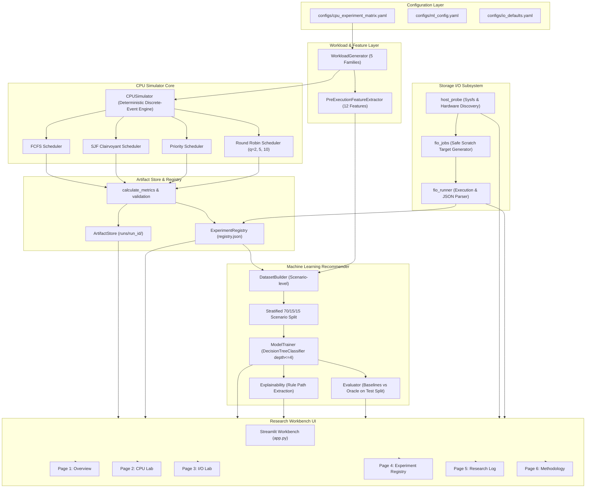

# System Architecture

## Architectural Separation of Concerns

1. **Pure Core Simulation (`src/scheduling_lab/core/`):** Contains zero UI or Streamlit dependencies. Implements discrete-event scheduling, lifecycle tracking, and invariant validation. Fully testable in headless CI environments.
2. **Deterministic Schedulers (`src/scheduling_lab/schedulers/`):** Polymorphic implementations behind `BaseScheduler` defining candidate selection and preemption rules.
3. **Leakage-Free Feature Extraction (`src/scheduling_lab/workloads/`):** Extracts 12 pre-execution summary features without touching post-run metrics.
4. **Immutable Experiment Persistence (`src/scheduling_lab/experiments/`):** Each run produces a self-contained, reproducible artifact directory with manifest, scenario, trace, timeline, and metrics.
5. **Explainable ML Engine (`src/scheduling_lab/ml/`):** Strictly scenario-grouped train/val/test partitioning; bounded Decision Tree for human-readable rule paths.
6. **I/O Safety Subsystem (`src/scheduling_lab/io_lab/`):** Enforces disposable scratch-file targeting; guarantees no raw block device access.
7. **Research Workbench Interface (`src/scheduling_lab/ui/`):** Instrument-style Streamlit dashboard reading directly from immutable saved artifacts.
